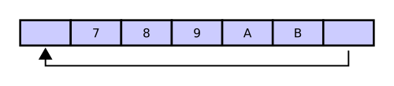

# Circular Buffer

A *circular buffer* (also called a *circular queue*, *cyclic buffer* or *ring buffer*) is a **[[Data Structures & Algorithms|data structure]]**, which is a specific way of organizing data in a computer's memory. It uses a single memory area of **fixed size** that is treated as if its start and end were connected. Once the last slot is reached, it continues at the first one. In memory, the buffer is just a normal row of slots. The "ring" comes only from the way it is accessed. Circular buffers are well suited for temporarily storing **data streams**, which are data that keep arriving and need to be processed. Early implementations were built directly in hardware.

## How It Works

A circular buffer follows the **FIFO** principle (*First In, First Out*): whatever is written first is also read first, like a queue at a checkout. Two markers control the process. The *write pointer* marks where the next element will be stored. The *read pointer* marks the oldest element that has not been read yet. When an element is read, only the read pointer moves forward by one position. The element that was read stays in memory until new data overwrites it.

What happens when the buffer is full depends on the application. In an *overwriting circular buffer*, the oldest data is replaced. Alternatively, the write can be rejected and an error reported.

## Uses and Advantages

The main advantage is that the remaining elements **do not have to be shifted** when an element is removed. With an ordinary linear buffer, every removal from the front would require moving all other elements forward, which takes time. This makes the circular buffer ideal for **queues with a fixed maximum size**. All operations run in *constant time*, which means their cost does not depend on the number of stored elements. The drawback shows up when the buffer needs to grow: memory contents must be copied, which is relatively expensive. For queues that need to grow without limit, a *linked list* is often the better choice.

Typical uses include keyboard buffers and multimedia systems. In the *producer–consumer problem*, one part of a program supplies data (e.g. an audio generator) while another part takes it (e.g. the sound card). Here it often makes sense to overwrite old data if the consumer briefly falls behind. The *LZ77 family* of compression algorithms, which reduce data size without losing information, also stores the most recently read data in a circular buffer. These algorithms assume that strings seen recently are likely to appear again soon.

## Technical Implementation

A circular buffer needs only three integers:

1. *start* - index of the first item in memory
2. *capacity* - length of the buffer
3. *size* - actual length of the buffer or amount of occupied slots

At the beginning, both - *start* and *size* are set to 0. Capacity is set to whatever value is needed or available (for example 100). When appending a new item to the end of the buffer, size increases by 1. If there are no slots available till the end of underlaying array, buffer appends the value to the start of it.

When removing an item, buffer increases *start* variable and the spot gets freed for new values. If this *start* variable was the last available physical spot in the underlaying array, instead of increasing it by 1 program turns it into 0.

In order to read the right data, program must extract not the underlaying array, but the values starting at index *start*, which can be in the middle of the array, and end at index *start + size*, if *start + size < capacity* or at *start + size - capacity*, if *start + size > capacity*.

---

*Based on the Wikipedia article [Circular buffer](https://en.wikipedia.org/wiki/Circular_buffer)*
