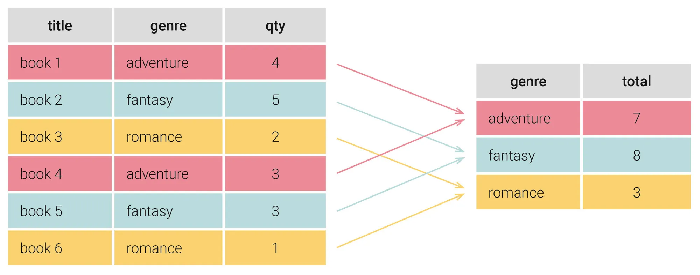

# GROUP BY in SQL

Die *GROUP BY-Klausel* gehört zu den wichtigsten Werkzeugen in [[SQL (DE)|SQL]], wenn es darum geht, Daten zu analysieren und aussagekräftige Statistiken zu berechnen. Sie ermöglicht es, Datensätze mit gemeinsamen Werten zu gruppieren und anschließend Berechnungen für jede dieser Gruppen durchzuführen.

## Was ist GROUP BY und wozu wird es verwendet?

*GROUP BY* ist eine SQL-Klausel, die Zeilen mit identischen Werten in einer oder mehreren Spalten zu einer Gruppe zusammenfasst. Im Kern funktioniert sie wie das Sortieren von Gegenständen in verschiedene Behälter: Alle Einträge mit demselben Merkmal landen im selben Behälter.

Ein klassisches Beispiel aus dem Alltag wäre eine Buchhandlung, die wissen möchte, wie viele Bücher sie pro Genre auf Lager hat. Anstatt jeden einzelnen Buchtitel zu betrachten, gruppiert *GROUP BY* alle Bücher desselben Genres und berechnet dann die Gesamtmenge pro Gruppe.

## Die Grundsyntax

Eine typische *GROUP BY*-Abfrage folgt diesem Aufbau:

~~~SQL
SELECT [ATTRIBUTE_NAME], [AGGREGATE_FUNCTION]([ATTRIBUTE_NAME])
FROM [TABLE_NAME]
GROUP BY [ATTRIBUTE_NAME];
~~~

Wichtig ist dabei: Alle Spalten, die in der *SELECT*-Anweisung aufgeführt werden und nicht Teil einer Aggregatfunktion sind, müssen auch in der *GROUP BY*-Klausel erscheinen.

## Aggregatfunktionen mit GROUP BY

Die eigentliche Stärke von *GROUP BY* entfaltet sich erst in Kombination mit [[SQL Aggregate Functions (DE)|Aggregatfunktionen]]. Diese Funktionen berechnen einen einzelnen Wert aus einer Menge von Datensätzen innerhalb einer Gruppe:

- *COUNT()* zählt die Anzahl der Zeilen in jeder Gruppe
- *SUM()* berechnet die Summe aller Werte
- *AVG()* ermittelt den Durchschnittswert
- *MIN()* findet den kleinsten Wert
- *MAX()* findet den größten Wert

Ein praktisches Beispiel mit einer Büchertabelle verdeutlicht dies. Um den Durchschnittspreis, den Mindestpreis und den Höchstpreis pro Buchgenre zu ermitteln, verwendet man folgende Abfrage:

~~~SQL
SELECT genre, MIN(price) AS min_preis, AVG(price) AS durchschnittspreis, MAX(price) AS max_preis
FROM books
GROUP BY genre;
~~~

Mögliche Ausgabe:

| genre | min_price | avg_price | max_price |
| - | - | - | - |
| adventure | 9.99 | 10.945 | 11.90 |
| fantasy | 7.99 | 8.24 | 8.49 |
| romance | 5.88 | 7.9359 | 99 |

Das Ergebnis zeigt für jedes Genre eine Zeile mit den berechneten Statistiken. So lassen sich mit wenigen Zeilen Code umfangreiche Datenanalysen durchführen.

## Gruppierung nach mehreren Spalten

*GROUP BY* ist nicht auf eine einzelne Spalte beschränkt. Es lassen sich auch mehrere Spalten kombinieren, um feinere Gruppierungen zu erstellen. Dabei bilden alle Datensätze eine Gruppe, die in sämtlichen angegebenen Spalten identische Werte aufweisen.

Möchte man beispielsweise die Anzahl der Buchtitel nach Genre und Sprache aufschlüsseln, sieht die Abfrage folgendermaßen aus:

~~~SQL
SELECT genre, sprache, COUNT(titel) AS anzahl_titel
FROM books
GROUP BY genre, sprache;
~~~

Das Ergebnis unterscheidet nun zwischen englischsprachigen und französischsprachigen Titeln innerhalb jedes Genres.

## HAVING: Gruppen filtern

Während *WHERE* einzelne Zeilen vor der Gruppierung filtert, ermöglicht *HAVING* das Filtern von bereits gebildeten Gruppen anhand von Aggregatwerten. Der entscheidende Unterschied liegt im Zeitpunkt der Filterung:

- *WHERE* wird **vor** der Gruppierung angewandt und filtert einzelne Datensätze
- *HAVING* wird **nach** der Gruppierung angewandt und filtert ganze Gruppen

Ein Beispiel verdeutlicht dies: Möchte man nur Genres anzeigen, die mehr als zwei Bücher enthalten, verwendet man *HAVING*:

~~~SQL
SELECT genre, COUNT(*) AS anzahl_buecher
FROM books
GROUP BY genre
HAVING COUNT(*) > 2;
~~~

*WHERE* kann hier nicht verwendet werden, da die Anzahl der Bücher pro Genre erst nach der Gruppierung bekannt ist. Versucht man, eine Aggregatfunktion in einer *WHERE*-Klausel zu verwenden, führt dies zu einem Fehler.

Beide Klauseln lassen sich auch kombinieren. Die folgende Abfrage filtert zunächst alle Bücher mit einem Preis über 5 Euro heraus und zeigt anschließend nur Genres mit einem Durchschnittspreis über 10 Euro:

~~~SQL
SELECT genre, AVG(price) AS durchschnittspreis
FROM books
WHERE price > 5
GROUP BY genre
HAVING AVG(price) > 10;
~~~

Die Reihenfolge in der Abfrage entspricht der logischen Verarbeitungsreihenfolge: *WHERE* filtert zuerst die Zeilen, *GROUP BY* bildet die Gruppen, und *HAVING* filtert abschließend die Gruppen.

## Häufige Fehlerquellen vermeiden

Bei der Arbeit mit *GROUP BY* treten bestimmte Fehler immer wieder auf. Der wichtigste Grundsatz lautet: Jede Spalte in der *SELECT*-Anweisung muss entweder in einer Aggregatfunktion verwendet werden oder in der *GROUP BY*-Klausel aufgeführt sein. Wird gegen diese Regel verstoßen, gibt die Datenbank eine Fehlermeldung aus.

Ein weiterer Aspekt betrifft *NULL-Werte*. Diese werden von *GROUP BY* als eigene Gruppe behandelt. Alle Datensätze mit NULL in der gruppierten Spalte landen somit gemeinsam in einer separaten Gruppe.

## Der Unterschied zu ORDER BY

*GROUP BY* und *ORDER BY* werden häufig verwechselt, erfüllen jedoch völlig unterschiedliche Aufgaben. Während *ORDER BY* lediglich die Reihenfolge der Ergebnisse sortiert, fasst *GROUP BY* Datensätze tatsächlich zusammen und reduziert damit die Anzahl der Zeilen in der Ausgabe. Die Anzahl der Ergebniszeilen entspricht bei *GROUP BY* der Anzahl der gebildeten Gruppen.

## Typische Anwendungsfälle

*GROUP BY* findet in nahezu allen Branchen Anwendung. Im Vertrieb lässt sich damit die Gesamtzahl verkaufter Produkte pro Kategorie ermitteln. Personalabteilungen können Durchschnittsgehälter nach Abteilungen berechnen. Im Bankwesen wird die Klausel genutzt, um Kundengruppen zu analysieren. Überall dort, wo Daten nach gemeinsamen Merkmalen ausgewertet werden sollen, ist *GROUP BY* das Mittel der Wahl.

---

*Quelle: [LearnSQL.de – GROUP BY in SQL erklärt](https://learnsql.de/blog/group-by-in-sql-erklaert/)*
