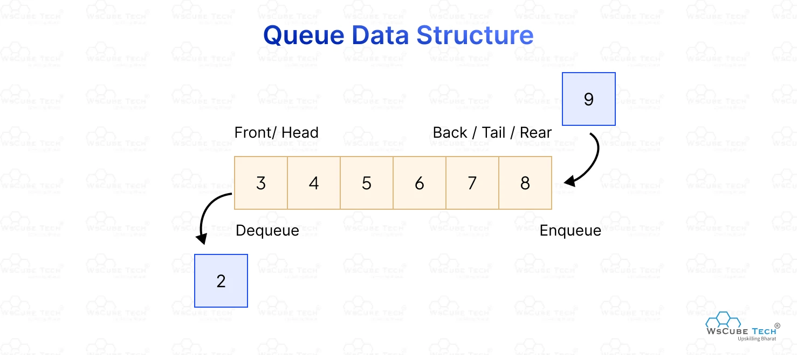

# Queue

A *queue* is an **abstract [[Data Structures & Algorithms|data type]]**. This term describes which operations a collection of data offers, but not how it is stored in memory. A queue is an ordered collection of elements and works like a line of people at a checkout: new elements join at the back, and the front is served first. The back end is called the *back*, *tail* or *rear*, and the front end is called the *head* or *front*.

A queue has two basic operations. *Enqueue* adds an element at the back. *Dequeue* removes the element at the front. Many queues also offer *peek*, which returns the next element without removing it.

This leads to the **FIFO principle** (*First In, First Out*): the element added first is also removed first. A new element only gets its turn after all older elements have been removed. Queues are *linear data structures* because their elements are arranged one after another in a fixed order.

## Uses

Queues are used in computer science, transportation and *operations research* (the mathematical planning of processes). They hold data, objects, people or events until these can be processed. In this role they act as a *buffer*, which is temporary storage. A well-known example from programming is *breadth-first search*. This method searches graphs such as networks or maps one level at a time and keeps the nodes it still has to visit in a queue.

## Capacity, Overflow and Underflow

In theory, a queue has **no fixed capacity**, so another element can always be added. In practice, the available memory limits its size. A *bounded queue*, by contrast, is deliberately limited to a fixed maximum number of elements. Trying to add an element to a full queue causes a *queue overflow*. Trying to remove an element from an empty queue causes a *queue underflow*.

## Efficient Implementations

An implementation is considered *efficient* if enqueue and dequeue run in *O(1)*. This notation means *constant time*: the cost stays the same no matter how many elements the queue contains. There are two common ways to achieve this.

The first is an **array used as a ring**. An *array* is a row of memory slots with a fixed size. It is treated as if its start and end were connected, and the head and tail move around it in a circle. This way, elements never have to be shifted when one is removed. Technically, positions are calculated *modulo n*, where *n* is the array size, so after the last slot the position goes back to 0. This structure is called a *[[Circular Buffer|circular buffer]]*. Its size must be set in advance, although some implementations double the array when an overflow occurs.

The second is a **linked list**, in which each element points to the next one. A *doubly linked list* can insert and remove at both ends in constant time, so it works as a queue right away. A *singly linked list* can normally do this at only one end. If it also keeps a pointer to the last element, however, it becomes an efficient queue as well.

---

*Based on the Wikipedia article [Queue (abstract data type)](https://en.wikipedia.org/wiki/Circular_buffer)*
